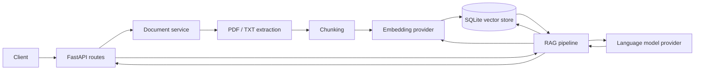

# Enterprise AI Knowledge & Workflow Agent

A modular FastAPI Retrieval-Augmented Generation (RAG) MVP. It accepts PDF and UTF-8 TXT files, extracts and chunks their text, stores vectors persistently, retrieves relevant passages, and returns answers with source metadata. It defaults to a local demo mode that needs no OpenAI credentials or paid API calls; OpenAI providers remain available as an explicit option.

## Business problem

Organizations keep useful policies and procedures in documents that are difficult to search. This service provides a small, auditable question-answering API that grounds responses in uploaded documents and returns the passages used as sources.

## Features

- PDF and UTF-8 TXT extraction, validation, size limits, and path-safe filenames.
- Configurable character chunking with overlap and page-aware PDF metadata.
- Local deterministic feature-hash embeddings and extractive answers for no-cost end-to-end demos.
- OpenAI embedding and chat provider adapters, configured through environment variables.
- Persistent SQLite storage for document metadata, chunks, and embeddings.
- Cosine-similarity retrieval, configurable top-k, optional document filtering, and source citations.
- Document upload, list, and delete API operations.
- Privacy-safe request logging, bounded provider timeouts/retries, safe API errors, and configurable CORS.
- Mock-based tests that do not make paid API calls.

## Architecture and request flow



Documents are read into memory, extracted, divided into chunks, embedded, and written to SQLite. Uploaded files are not saved. For a question, the service embeds the query, ranks stored chunks by cosine similarity, and filters low-scoring results. Local mode selects sentences from retrieved passages; OpenAI mode requests a grounded answer from the configured language model. The API returns the answer and structured source citations. If no useful passage is found, both modes return a safe no-information response.

## Technology stack

- Python 3.14 (the installed project interpreter is Python 3.14.7)
- FastAPI and Pydantic
- SQLite for persistent document and vector data
- pypdf for PDF text extraction
- OpenAI Python SDK for the optional paid provider mode
- Python standard library for local feature hashing and extractive answers
- pytest for automated tests

### Vector storage choice

The MVP uses a SQLite table with JSON-encoded vectors and a cosine-similarity scan. This gives the project durable local storage without requiring a separate database service, which suits a small portfolio demo and this environment (Docker is not installed). Search time grows linearly with the number of chunks, so this is not intended for a large corpus. A future scale-up can move the store interface to PostgreSQL with pgvector.

## Project structure

```text
app/
  chunking.py          # configurable text chunking
  config.py            # environment settings
  document_service.py  # ingestion, list, delete
  embeddings.py        # local and OpenAI embedding providers
  errors.py            # safe application exceptions
  llm.py               # extractive and OpenAI answer providers
  local_text.py        # shared local token handling
  logging_config.py    # privacy-conscious logging setup
  models.py            # shared data objects
  rag.py               # retrieval, context assembly, citations
  routes.py             # FastAPI endpoints and error mapping
  services.py          # application service composition
  text_extraction.py   # TXT and PDF extraction
  vector_store.py      # persistent SQLite cosine-search store
tests/                 # API, service, provider, and Python learning tests
main.py                # FastAPI app factory and application entry point
Dockerfile
docker-compose.yml
```

## Requirements and configuration

Install Python 3.14 and create an environment. Local mode is selected by default and does not require an API key:

```powershell
py -3.14 -m venv .venv
.\.venv\Scripts\Activate.ps1
python -m pip install -r requirements.txt
if (-not (Test-Path .env)) { Copy-Item .env.example .env }
```

With `AI_MODE=local`, upload, retrieval, and answering run without OpenAI credentials or network calls. To opt into OpenAI, set `AI_MODE=openai` and `OPENAI_API_KEY` in `.env`; obtain a key from the [OpenAI API dashboard](https://platform.openai.com/api-keys). OpenAI requests can incur charges. Local mode never falls back to OpenAI if its provider fails.

| Variable | Default | Purpose |
| --- | --- | --- |
| `AI_MODE` | `local` | Selects `local` or `openai`; invalid values stop startup |
| `OPENAI_API_KEY` | unset | Credential used only when `AI_MODE=openai` |
| `APP_NAME` | `Enterprise AI Knowledge & Workflow Agent` | Root response and API title |
| `LOG_LEVEL` | `INFO` | Application log level |
| `EMBEDDING_MODEL` | `text-embedding-3-small` | OpenAI embedding model |
| `CHAT_MODEL` | `gpt-4.1-mini` | OpenAI answer model |
| `DATABASE_PATH` | `data/knowledge.db` | SQLite file path for OpenAI mode |
| `LOCAL_DATABASE_PATH` | `data/knowledge-local.db` | Separate SQLite file for local mode |
| `CHUNK_SIZE` | `1000` | Approximate maximum characters per chunk |
| `CHUNK_OVERLAP` | `150` | Character overlap between chunks |
| `TOP_K` | `4` | Maximum retrieved passages (1–20) |
| `MIN_RELEVANCE_SCORE` | `0.15` | Minimum cosine score included in context (0–1) |
| `MAX_UPLOAD_BYTES` | `10485760` | Maximum upload size (10 MiB) |
| `CORS_ALLOWED_ORIGINS` | `http://localhost:3000,http://127.0.0.1:3000` | Comma-separated allowed origins |

Chunking normalizes repeated whitespace, prefers word boundaries where possible, and applies overlap to retain context between neighboring chunks. PDF pages are chunked separately so page citations remain accurate. Scanned-image PDFs do not contain extractable text and are rejected as empty; OCR is not included.

SQLite creates its tables and indexes automatically when the store is first initialized. Back up the database file selected for the active mode (`LOCAL_DATABASE_PATH` or `DATABASE_PATH`); in Compose, back up the `agent-data` volume.

The selected embedding model is recorded in the store. Changing `EMBEDDING_MODEL` for an existing non-empty store is rejected because vectors from different models cannot be compared reliably; configure a new database and re-ingest the source documents to migrate.

Local mode has its own database file so it will not mix local vectors with an existing OpenAI-backed index. Switching modes does not migrate or overwrite the other mode's documents; each mode maintains a separate index.

### Local demo mode and OpenAI mode

`AI_MODE=local` is the default. Its embedding provider hashes normalized word and adjacent-word features into a fixed-size vector using only the Python standard library. The result is deterministic and searchable by cosine similarity, but it is a lightweight keyword-feature approximation: it does not understand meaning, synonyms, or context like a trained embedding model. Hash collisions are possible.

The local answer provider selects up to three sentences from retrieved chunks when their content words overlap the question. It appends the source label to each selected sentence and returns a no-information message when there is no word overlap. It does not paraphrase or synthesize new claims and is not equivalent to an LLM.

To use OpenAI later, set `AI_MODE=openai` and provide `OPENAI_API_KEY`. This explicitly enables live embedding and chat requests, which may incur charges. If a provider call fails, the application reports an error; it never switches modes automatically.

## Run locally

```powershell
.\.venv\Scripts\Activate.ps1
python -m uvicorn main:app --reload
```

Open Swagger UI at `http://127.0.0.1:8000/docs`. The liveness endpoint is `/health`; `/ready` checks SQLite readiness.

## API

All endpoints are documented in Swagger/OpenAPI.

| Method | Path | Behavior |
| --- | --- | --- |
| `GET` | `/` | Existing project status response |
| `GET` | `/health` | Liveness check |
| `GET` | `/ready` | SQLite readiness check |
| `POST` | `/documents/upload` | Stream a PDF or TXT file into ingestion |
| `GET` | `/documents` | List indexed documents and chunk counts |
| `DELETE` | `/documents/{document_id}` | Delete a document and all its chunks |
| `POST` | `/ask` | Retrieve passages and return an answer with sources |

Upload the raw file bytes with `X-Filename` and `Content-Type: application/octet-stream`:

```powershell
curl.exe -X POST "http://127.0.0.1:8000/documents/upload" `
  -H "X-Filename: handbook.txt" `
  -H "Content-Type: application/octet-stream" `
  --data-binary "@handbook.txt"
```

Ask a question:

```powershell
curl.exe -X POST "http://127.0.0.1:8000/ask" `
  -H "Content-Type: application/json" `
  -d '{"question":"What does the handbook say about access reviews?"}'
```

The answer response includes `question`, `answer`, and `sources`. Each source has a document ID, original filename, chunk ID, optional PDF page number, and relevance score. You can scope retrieval with `{"question":"...","document_id":"..."}`.

List indexed documents and delete a document with:

```powershell
curl.exe "http://127.0.0.1:8000/documents"
curl.exe -X DELETE "http://127.0.0.1:8000/documents/<document-id>"
```

## Tests

Install the requirements, then run the full suite:

```powershell
python -m pytest -p no:cacheprovider
```

All provider and storage tests use local fakes and do not call paid APIs. When run inside Codex's restricted process environment, HTTP tests can stall before reaching a route because Windows' Proactor loop cannot open its fallback local socket pair there. With local socket access enabled, the complete suite passed on the same Python 3.14.7 interpreter. No event-loop workaround is applied. To run only non-HTTP tests inside the restricted process environment, use:

```powershell
python -m pytest -p no:cacheprovider -m "not http"
```

The HTTP tests remain enabled and run in the Ubuntu GitHub Actions workflow. The bounded comparison confirmed this is a process-environment restriction rather than an application or Python 3.14 compatibility failure.

## Docker deployment

Docker and Docker Compose are not installed in the current workspace, so the container configuration is supplied but cannot be built or run here.

1. Install Docker Desktop with Compose support.
2. Local demo mode is the default and needs no API key. To use OpenAI providers, set `AI_MODE=openai` and `OPENAI_API_KEY` in your shell or `.env` file.
3. From the repository directory, run:

   ```powershell
   docker compose up --build -d
   docker compose ps
   docker compose logs -f api
   ```

4. Open `http://localhost:8000/docs` and check `http://localhost:8000/ready`.
5. Stop the API with `docker compose down`. The named `agent-data` volume retains SQLite data. To intentionally remove that persistent data, use `docker compose down -v`.

The container runs as a non-root user. Secrets are passed through the environment, not copied into the image. SQLite lives in the mounted volume; local mode uses `/data/knowledge-local.db`, while OpenAI mode uses `/data/knowledge.db`.

## Known limitations and future improvements

- SQLite similarity search scans all stored vectors; migrate to pgvector for larger corpora or concurrent workloads.
- The app has no user authentication, authorization, tenant isolation, malware scanning, or per-user document permissions. Do not expose it publicly with sensitive data as-is.
- Text-only PDFs are supported; OCR, Office documents, and HTML are not.
- OpenAI mode is instructed to stay within context, but generated prose is probabilistic. Local mode returns selected source sentences and can miss relevant wording when terms differ. Verify consequential answers against the returned sources.
- No job queue, streaming answers, feedback capture, workflow actions, or frontend is included.
- Add authentication/authorization, OCR, PostgreSQL with pgvector, background ingestion, rate limiting, and evaluation/monitoring before production use.

## Interview explanation

This is a modular RAG API. Ingestion validates uploads, extracts text, chunks by character windows with overlap, embeds chunks through a provider interface, and stores vectors plus source metadata in SQLite. At question time it embeds the question, ranks chunks with cosine similarity, filters by a configurable score, and returns source citations. Local mode selects matching sentences from the retrieved passages; optional OpenAI mode asks the configured language model to answer from the same source-labeled context. Provider interfaces and fake-backed tests keep business logic testable without API calls. SQLite keeps local deployment simple; its linear search and lack of authentication are explicit MVP limits.

### Interview questions and answers

**Why use RAG instead of putting the documents directly in a prompt?** The service retrieves a small number of relevant chunks, so the prompt stays bounded and the response can identify which indexed passages were used.

**How do you preserve source references?** Each chunk stores its document ID, filename, timestamp, and optional PDF page. Retrieval carries that metadata through to the response's `sources` list.

**Why SQLite instead of pgvector?** SQLite makes the MVP persistent and easy to run locally without a database service. The tradeoff is a linear similarity scan, which is suitable only for a small corpus.

**How are the integrations tested without paid API calls?** Ingestion and RAG depend on embedding and language-model interfaces. Tests inject small fakes, and provider adapter tests use fake SDK-shaped clients.

**How do you reduce unsupported answers?** Retrieval applies a minimum similarity score. The system prompt tells the model to use only retrieved context and acknowledge when evidence is missing; the API returns source metadata for review. This reduces risk but cannot guarantee that generated prose is always correct.

**What would you change before a production rollout?** Add authentication and per-document authorization, move vectors to pgvector when the corpus grows, add OCR/background ingestion, and evaluate retrieval and answer quality on a representative dataset.

### Resume bullet points

- Built a modular FastAPI RAG API for PDF/TXT ingestion, text extraction, configurable chunking, embedding, similarity retrieval, and source-aware answers.
- Implemented persistent SQLite vector storage with cosine ranking, document filtering/deletion, chunk metadata, and configurable retrieval limits.
- Added mock-backed tests for ingestion, chunking, storage, provider adapters, retrieval, error handling, citations, and API behavior; **102 tests passed** in the current Python 3.14.7 environment.
