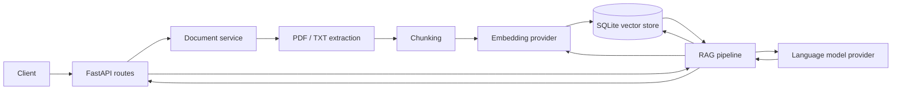

# Enterprise AI Knowledge & Workflow Agent

A modular FastAPI Retrieval-Augmented Generation (RAG) MVP. It accepts PDF and UTF-8 TXT files, extracts and chunks their text, stores vectors persistently, retrieves relevant passages, and returns answers with source metadata. It defaults to a local demo mode that needs no OpenAI credentials or paid API calls; OpenAI providers remain available as an explicit option.

## Business problem

Organizations keep useful policies and procedures in documents that are difficult to search. This service provides a small, auditable question-answering API that grounds responses in uploaded documents and returns the passages used as sources.

## Features

- PDF and UTF-8 TXT extraction, validation, size limits, and path-safe filenames.
- Configurable character chunking with overlap and page-aware PDF metadata.
- Local deterministic feature-hash embeddings and extractive answers for no-cost end-to-end demos.
- OpenAI embedding and chat provider adapters, configured through environment variables.
- Persistent SQLite storage for document metadata, chunks, and embeddings.
- Bearer-token authentication with user-owned document listing, retrieval, and deletion.
- Cosine-similarity retrieval, configurable top-k, optional document filtering, and source citations.
- Document upload, list, and delete API operations.
- Privacy-safe request logging, bounded uploads and PDF processing, authenticated rate limits, safe API errors, and configurable CORS.
- Mock-based tests that do not make paid API calls.

## Architecture and request flow



Documents are read into memory, extracted, divided into chunks, embedded, and written to SQLite. Uploaded files are not saved. For a question, the service embeds the query, ranks stored chunks by cosine similarity, and filters low-scoring results. Local mode selects sentences from retrieved passages; OpenAI mode requests a grounded answer from the configured language model. The API returns the answer and structured source citations. If no useful passage is found, both modes return a safe no-information response.

## Technology stack

- Python 3.14 (the installed project interpreter is Python 3.14.7)
- FastAPI and Pydantic
- SQLite for persistent document and vector data
- pypdf for PDF text extraction
- OpenAI Python SDK for the optional paid provider mode
- Python standard library for local feature hashing and extractive answers
- pytest for automated tests

### Vector storage choice

The MVP uses a SQLite table with JSON-encoded vectors and a cosine-similarity scan. This gives the project durable local storage without requiring a separate database service. Search time grows linearly with the number of chunks, so this is intended for a small corpus. A future scale-up can move the store interface to PostgreSQL with pgvector.

## Project structure

```text
app/
  auth.py              # bearer-token authentication
  chunking.py          # configurable text chunking
  config.py            # environment settings
  dependencies.py      # lazy service dependency
  document_service.py  # ingestion, list, delete
  embeddings.py        # local and OpenAI embedding providers
  errors.py            # safe application exceptions
  limits.py            # upload and request limits
  llm.py               # extractive and OpenAI answer providers
  local_text.py        # shared local token handling
  logging_config.py    # privacy-conscious logging setup
  models.py            # shared data objects
  provisioning.py      # administrator user/token CLI
  rag.py               # retrieval, context assembly, citations
  routes.py            # FastAPI endpoints and error mapping
  services.py          # application service composition
  text_extraction.py   # TXT and PDF extraction
  vector_store.py      # persistent SQLite cosine-search store
docs/                  # architecture and technical decisions
tests/                 # API, service, provider, and Python learning tests
main.py                # FastAPI app factory and application entry point
Dockerfile
docker-compose.yml
```

## Requirements and configuration

Install Python 3.14 and create an environment. Local mode is selected by default and does not require an API key:

```powershell
py -3.14 -m venv .venv
.\.venv\Scripts\Activate.ps1
python -m pip install -r requirements.txt
if (-not (Test-Path .env)) { Copy-Item .env.example .env }
```

With `AI_MODE=local`, upload, retrieval, and answering run without OpenAI credentials or network calls. To opt into OpenAI, set `AI_MODE=openai` and `OPENAI_API_KEY` in `.env`; obtain a key from the [OpenAI API dashboard](https://platform.openai.com/api-keys). OpenAI requests can incur charges. Local mode never falls back to OpenAI if its provider fails.

| Variable | Default | Purpose |
| --- | --- | --- |
| `AI_MODE` | `local` | Selects `local` or `openai`; invalid values stop startup |
| `OPENAI_API_KEY` | unset | Credential used only when `AI_MODE=openai` |
| `APP_NAME` | `Enterprise AI Knowledge & Workflow Agent` | Root response and API title |
| `LOG_LEVEL` | `INFO` | Application log level |
| `EMBEDDING_MODEL` | `text-embedding-3-small` | OpenAI embedding model |
| `CHAT_MODEL` | `gpt-4.1-mini` | OpenAI answer model |
| `DATABASE_PATH` | `data/knowledge.db` | SQLite file path for OpenAI mode |
| `LOCAL_DATABASE_PATH` | `data/knowledge-local.db` | Separate SQLite file for local mode |
| `CHUNK_SIZE` | `1000` | Approximate maximum characters per chunk |
| `CHUNK_OVERLAP` | `150` | Character overlap between chunks |
| `TOP_K` | `4` | Maximum retrieved passages (1–20) |
| `MIN_RELEVANCE_SCORE` | `0.15` | Shared fallback minimum cosine score (0–1) |
| `LOCAL_MIN_RELEVANCE_SCORE` | unset | Optional local provider override; tune with local evaluation cases |
| `OPENAI_MIN_RELEVANCE_SCORE` | unset | Optional OpenAI provider override; tune separately for that model |
| `MAX_UPLOAD_BYTES` | `10485760` | Maximum upload size (10 MiB) |
| `MAX_CONCURRENT_UPLOADS` | `2` | Concurrent ingestion limit per process |
| `UPLOAD_WAIT_TIMEOUT_SECONDS` | `5` | Maximum wait for an upload slot |
| `MAX_PDF_PAGES` | `200` | Maximum pages per PDF |
| `MAX_EXTRACTED_TEXT_CHARS` | `2000000` | Maximum extracted characters per document |
| `RATE_LIMIT_REQUESTS` | `120` | Authenticated requests per user in the window |
| `RATE_LIMIT_WINDOW_SECONDS` | `60` | Per-user sliding-window length |
| `CORS_ALLOWED_ORIGINS` | `http://localhost:3000,http://127.0.0.1:3000` | Comma-separated allowed origins |

Chunking normalizes repeated whitespace, prefers word boundaries where possible, and applies overlap to retain context between neighboring chunks. PDF pages are chunked separately so page citations remain accurate. Scanned-image PDFs do not contain extractable text and are rejected as empty; OCR is not included.

SQLite creates its tables and indexes automatically when the store is first initialized. Back up the database file selected for the active mode (`LOCAL_DATABASE_PATH` or `DATABASE_PATH`); in Compose, back up the `agent-data` volume.

The selected embedding model is recorded in the store. Changing `EMBEDDING_MODEL` for an existing non-empty store is rejected because vectors from different models cannot be compared reliably; configure a new database and re-ingest the source documents to migrate.

Local mode has its own database file so it will not mix local vectors with an existing OpenAI-backed index. Switching modes does not migrate or overwrite the other mode's documents; each mode maintains a separate index.

### Local demo mode and OpenAI mode

`AI_MODE=local` is the default. Its embedding provider hashes normalized word and adjacent-word features into a fixed-size vector using only the Python standard library. The result is deterministic and searchable by cosine similarity, but it is a lightweight keyword-feature approximation: it does not understand meaning, synonyms, or context like a trained embedding model. Hash collisions are possible.

The local answer provider selects up to three sentences from retrieved chunks. A sentence must cover at least half of the question's meaningful terms; candidates are ranked by question coverage and sentence precision. It appends each selected sentence's source label and abstains with the shared no-information response when evidence is insufficient. This is still lexical matching: it does not understand meaning, paraphrase, or synthesize claims, and is not equivalent to an LLM.

Retrieval applies the configured minimum score to all owner- and document-scoped candidates before taking the top-k passages. Local feature-hash and OpenAI embedding scores can have different distributions, so `LOCAL_MIN_RELEVANCE_SCORE` and `OPENAI_MIN_RELEVANCE_SCORE` can override the shared fallback independently. The repository's small evaluation set is a regression smoke test, not a universal score calibration dataset.

To use OpenAI later, set `AI_MODE=openai` and provide `OPENAI_API_KEY`. This explicitly enables live embedding and chat requests, which may incur charges. If a provider call fails, the application reports an error; it never switches modes automatically.

## Run locally

```powershell
.\.venv\Scripts\Activate.ps1
python -m uvicorn main:app --reload
```

Open Swagger UI at `http://127.0.0.1:8000/docs`. The liveness endpoint is `/health`; `/ready` checks SQLite readiness.

Provision an API user from an interactive terminal before calling protected document endpoints. The plaintext token is displayed once; store it securely. SQLite stores only its SHA-256 hash.

```powershell
python -m app.provisioning create-user --display-name "Local user" --label "development"
python -m app.provisioning revoke --token-id <token-id>
```

## API

All endpoints are documented in Swagger/OpenAPI.

| Method | Path | Behavior |
| --- | --- | --- |
| `GET` | `/` | Existing project status response |
| `GET` | `/health` | Liveness check |
| `GET` | `/ready` | SQLite readiness check |
| `POST` | `/documents/upload` | Stream a PDF or TXT file into ingestion |
| `GET` | `/documents` | List indexed documents and chunk counts |
| `DELETE` | `/documents/{document_id}` | Delete a document and all its chunks |
| `POST` | `/ask` | Retrieve passages and return an answer with sources |

`/`, `/health`, and `/ready` are public. Upload, list, delete, and ask require `Authorization: Bearer <token>`. Documents are scoped to their owner in the SQLite queries. Legacy documents without an owner remain stored but are not visible in user-scoped list or search results; specific access and deletion return 404.

Upload the raw file bytes with `X-Filename` and `Content-Type: application/octet-stream`:

```powershell
curl.exe -X POST "http://127.0.0.1:8000/documents/upload" `
  -H "Authorization: Bearer $env:AGENT_API_TOKEN" `
  -H "X-Filename: handbook.txt" `
  -H "Content-Type: application/octet-stream" `
  --data-binary "@handbook.txt"
```

Ask a question:

```powershell
curl.exe -X POST "http://127.0.0.1:8000/ask" `
  -H "Authorization: Bearer $env:AGENT_API_TOKEN" `
  -H "Content-Type: application/json" `
  -d '{"question":"What does the handbook say about access reviews?"}'
```

The answer response includes `question`, `answer`, and `sources`. Each source has a document ID, original filename, chunk ID, optional PDF page number, and relevance score. Sources correspond only to source labels cited by the returned answer. Missing or invalid source references produce the no-information response with an empty source list. You can scope retrieval with `{"question":"...","document_id":"..."}`.

List indexed documents and delete a document with:

```powershell
curl.exe "http://127.0.0.1:8000/documents" -H "Authorization: Bearer $env:AGENT_API_TOKEN"
curl.exe -X DELETE "http://127.0.0.1:8000/documents/<document-id>" -H "Authorization: Bearer $env:AGENT_API_TOKEN"
```

## Tests

Install the requirements, then run the full suite:

```powershell
python -m pytest -p no:cacheprovider
```

All provider and storage tests use local fakes and do not call paid APIs. HTTP tests are marked `http` so the non-HTTP suite can run separately where Windows' Proactor loop cannot create its fallback local socket pair. No event-loop workaround is applied. Run non-HTTP tests with:

```powershell
python -m pytest -p no:cacheprovider -m "not http"
```

The HTTP tests remain enabled in the complete suite and CI. A passing non-HTTP run does not replace running the HTTP tests in an environment where the Windows event loop can initialize.

Run the deterministic local RAG quality smoke set independently with:

```powershell
python -m pytest -p no:cacheprovider tests/test_rag_evaluation.py
```

It uses the local embedding and extractive providers only; it does not call OpenAI or require API credits.

## Docker deployment

Compose defaults to local demo mode and binds the published API port to `127.0.0.1`. The service runs as a non-root user, with a read-only root filesystem, temporary `/tmp`, dropped Linux capabilities, and the named `agent-data` volume mounted at `/data`. Compose does not pass an OpenAI API key; keep this container in local mode. OpenAI mode remains available for direct local runs when explicitly configured.

1. Install Docker Desktop with Compose support.
2. Compose intentionally runs only the no-key local mode. For a direct local Python run, OpenAI providers can be enabled with `AI_MODE=openai` and `OPENAI_API_KEY` in the shell or ignored `.env` file; this may incur charges.
3. From the repository directory, run:

   ```powershell
   docker compose up --build -d
   docker compose ps
   docker compose logs -f api
   ```

4. Open `http://localhost:8000/docs` and check `http://localhost:8000/ready`.
5. Stop the API with `docker compose down`. The named `agent-data` volume retains SQLite data. To intentionally remove that persistent data, use `docker compose down -v`.

SQLite lives in the mounted volume; local mode uses `/data/knowledge-local.db`. Avoid `docker compose down -v` unless you intentionally want to remove the persistent database volume.

## Known limitations and future improvements

- SQLite similarity search scans all stored vectors; migrate to pgvector for larger corpora or concurrent workloads.
- Authentication and document ownership are implemented, but this remains a local demonstration service. Rate limits are process-local; there is no administrator web interface or malware scanning. Do not expose it publicly with sensitive data without a deployment-specific security review.
- Text-only PDFs are supported; OCR, Office documents, and HTML are not.
- OpenAI mode is instructed to stay within context, but generated prose is probabilistic. Local mode returns selected source sentences and can miss relevant wording when terms differ. Verify consequential answers against the returned sources.
- No job queue, streaming answers, feedback capture, workflow actions, or frontend is included.
- Consider shared rate limiting, malware scanning, OCR, PostgreSQL with pgvector, background ingestion, and retrieval-quality monitoring before production use.
