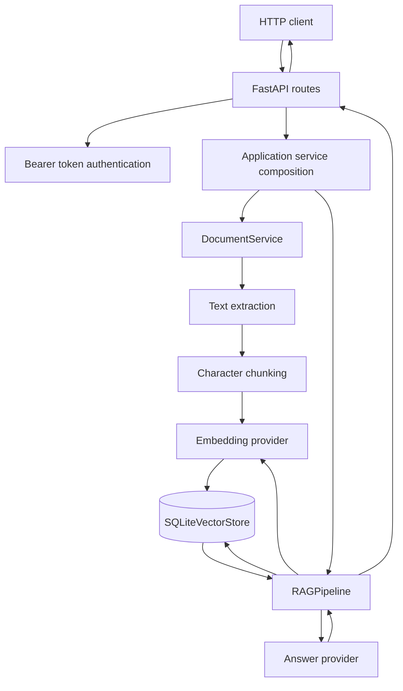
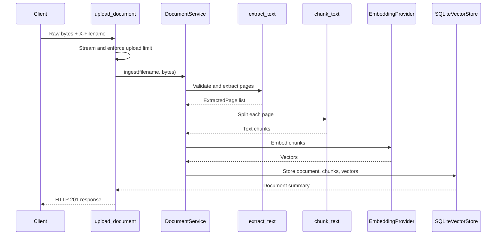

# Application Architecture

## 1. System overview

The project is a Python API built with FastAPI. It accepts PDF and UTF-8 text files, extracts their text, divides it into chunks, creates an embedding vector for each chunk, and stores the text and vectors in SQLite. A question is embedded with the same configured provider, compared with stored vectors, and answered from the highest-scoring chunks that meet the configured relevance threshold.

The default `local` mode runs embeddings and answer selection locally. Optional `openai` mode uses OpenAI for embeddings and answer generation. Both modes use the same document, retrieval, and storage workflow.

## 2. High-level architecture

The application is a modular monolith: its HTTP routes, document processing, provider adapters, retrieval logic, and storage implementation run in one process. `main.py` constructs the FastAPI application. Route dependencies create `ApplicationServices` lazily on first use, avoiding database initialization just because the module was imported. Tests can inject settings and services when constructing the app.

## 3. Main application components

| Component | Responsibility |
| --- | --- |
| `main.py` | Creates the FastAPI app, applies CORS settings, registers routes and exception handlers, and configures logging. |
| `app/routes.py` | Defines health, readiness, upload, list, delete, and question-answering endpoints; validates request and response shapes. |
| `app/auth.py` | Hashes bearer tokens, resolves active users, and applies the per-user request limit. |
| `app/provisioning.py` | Provides administrator-controlled user/token issuance and revocation commands. |
| `app/limits.py` | Bounds concurrent ingestion and process-local authenticated request counts. |
| `app/services.py` | Builds and wires providers, `DocumentService`, `RAGPipeline`, and `SQLiteVectorStore` according to settings. |
| `app/document_service.py` | Validates and ingests documents, creates chunk records and embeddings, and delegates persistence, listing, and deletion to the store. |
| `app/text_extraction.py` | Validates filenames and extracts text from UTF-8 TXT and text-based PDF files. |
| `app/chunking.py` | Normalizes whitespace and splits text into character windows with configured overlap. |
| `app/embeddings.py` | Defines the embedding interface and local and OpenAI implementations. |
| `app/vector_store.py` | Persists document metadata, chunks, vectors, and model metadata in SQLite; performs cosine-similarity search. |
| `app/rag.py` | Coordinates query embedding, retrieval, relevance filtering, context assembly, answer generation, and response citations. |
| `app/llm.py` | Defines the answer-provider interface, local extractive answer selection, and the OpenAI chat adapter. |
| `app/config.py` | Loads and validates environment-based application settings. |
| `app/models.py` | Defines immutable data records shared by extraction, ingestion, storage, and retrieval. |
| `app/errors.py` | Defines expected application exceptions that the route layer maps to HTTP responses. |
| `app/logging_config.py` | Configures the application logging level and format. |

There is no `app/retrieval.py` module in the repository. Retrieval currently lives in `SQLiteVectorStore.search()` and is orchestrated by `RAGPipeline.answer()`.

## 4. Document ingestion workflow

The upload route requires an authenticated user and accepts the raw file body as `application/octet-stream` with the plain filename in `X-Filename`. It checks `Content-Length` when available and streams request chunks into a bounded byte buffer to enforce `MAX_UPLOAD_BYTES`. A process-local concurrency limiter bounds simultaneous ingestion. This endpoint does not parse multipart form uploads.

The route passes the filename and collected bytes to `DocumentService.ingest()`. The service validates the filename and size, extracts pages, chunks each page, assigns document and chunk identifiers and ingestion timestamps, embeds all chunks, then asks the SQLite store to persist the document and its chunks. A successful request returns the document identifier, filename, timestamp, and chunk count.

## 5. Text extraction and chunking

`validate_filename()` allows only plain filenames with `.txt` or `.pdf` extensions. It rejects paths, null bytes, unsupported extensions, empty names, and names longer than 255 characters. TXT extraction is bounded by `MAX_EXTRACTED_TEXT_CHARS`. PDF extraction also enforces `MAX_PDF_PAGES` and the extracted-text cap, and configures pypdf recovery and cross-reference entry limits.

For TXT files, `extract_text()` decodes UTF-8 using `utf-8-sig`, which also removes a UTF-8 byte-order mark at the start of the file. Empty text and invalid UTF-8 are rejected. For PDF files, it requires a `%PDF-` signature and uses `pypdf` to extract text page by page. The page number is carried into each chunk. Encrypted PDFs and PDFs with no extractable text are rejected; OCR is not implemented.

`chunk_text()` collapses whitespace to single spaces, then creates character-sized windows. It prefers a space boundary when possible and advances the next window by the configured overlap. Each PDF page is chunked separately so chunks retain their originating page number. Chunking operates on text in memory; original uploaded files are not saved by the ingestion service.

## 6. Embedding generation

The `EmbeddingProvider` interface accepts a list of strings and returns one vector per string. The same configured provider embeds document chunks during ingestion and questions during retrieval. This consistency matters because the store compares vectors from the same embedding space.

`LocalEmbeddingProvider` uses only the Python standard library. It tokenizes content words, creates unigram and adjacent-token bigram features, hashes those features deterministically into 384 dimensions by default, and normalizes each vector. This makes local demos reproducible without downloading a model. It is a lexical feature approximation: it does not understand synonyms or meaning, and hash collisions can occur.

`OpenAIEmbeddingProvider` lazily creates an OpenAI client when embeddings are requested. It sends batches of up to 64 texts to the configured model and checks that the response count and dimensions are consistent. The client uses a 30-second timeout and two retries. Selecting this provider requires an API key and may incur usage charges.

## 7. Vector storage and retrieval

`SQLiteVectorStore` creates the document/vector tables and the identity tables when initialized:

- `documents` stores document identifiers, filenames, ingestion timestamps, and nullable `owner_id`.
- `chunks` stores chunk text, page number, timestamps, and JSON-encoded embedding vectors. A foreign key links each chunk to its document and cascades document deletion to its chunks.
- `store_metadata` records the embedding model identifier and vector dimension.
- `users` stores stable IDs, display names, creation times, and active status.
- `api_tokens` stores unique SHA-256 token hashes, user links, optional labels, creation times, and revocation timestamps. Plaintext tokens are displayed once by the provisioning CLI and are never stored.

The store verifies that vectors are finite, non-empty, consistent in dimension, and compatible with the metadata in the database. It rejects a different embedding model when the database already has vectors. SQLite connections enable foreign keys, use a 10-second busy timeout, and close after each operation; writes run within transaction contexts. New POSIX database files use mode `0600`. A versioned migration preserves existing documents with `owner_id=NULL` rather than assigning them arbitrarily.

`search()` optionally filters chunks by document ID and owner ID, computes cosine similarity in Python, sorts matches by score, and returns up to `TOP_K` results. Owner filtering happens in SQL, not after result retrieval. This scans selected stored vectors rather than using a dedicated vector index, so search cost grows with the number of chunks. `RAGPipeline` then removes results below `MIN_RELEVANCE_SCORE`.

## 8. Question-answering workflow

For `POST /ask`, the route resolves the bearer token to an active user, validates and trims the question, and passes the user ID to `RAGPipeline.answer()`. The pipeline validates an optional document ID against that owner, embeds the question, searches with an owner filter, and drops results below the relevance threshold. A missing or non-owned specific document returns the same 404. If no suitable results remain, it returns the safe no-information response without invoking an answer provider.

For remaining results, the pipeline formats context blocks with source labels and chunk text. It passes that context and the question to the configured `LanguageModelProvider`. If the provider returns its local no-information response, the pipeline returns no citations. Otherwise it returns the answer and structured citation metadata for the retrieved results.

### Local extractive answering

`ExtractiveAnswerProvider` compares question content words with sentences in the retrieved context. It selects up to three matching sentences and appends each sentence's source label. It copies text from retrieved chunks rather than generating paraphrases or new claims. If there are no matching terms or no valid source-labeled sentences, it returns a no-information message.

### OpenAI-powered answering

`OpenAILanguageModel` sends the question and source-labeled context to the configured OpenAI chat model. Its system instruction treats document text as untrusted reference data, requests an answer based only on the supplied context, asks for source-label citations, and directs the model to acknowledge missing evidence. The response is generated prose and may be probabilistic; the instruction cannot guarantee correctness.

## 9. Source attribution

Before answer generation, `RAGPipeline` labels each retrieved chunk as `[Source N: filename]`, adding a page number for PDF chunks. The local provider places these labels directly after selected sentences. The OpenAI provider receives the labels in its context and is instructed to cite them in its answer.

The API also returns a `sources` array containing document ID, filename, chunk ID, optional page number, and relevance score for the retrieved chunks. This is structured retrieval metadata; in OpenAI mode it does not independently verify which returned chunks support each generated claim. If the system has no relevant context or the local provider finds no matching sentence, the sources array is empty.

## 10. Local mode and OpenAI mode

`AI_MODE` is validated as either `local` or `openai` and defaults to `local`. `build_services()` selects the embedding and answer providers together, so ingestion and queries use the same mode. Local mode does not require OpenAI credentials and does not fall back to OpenAI when local processing fails.

| Mode | Embeddings | Answering | Credentials and network |
| --- | --- | --- | --- |
| `local` | Deterministic feature hashing in the application process | Selects matching sentences from retrieved chunks | No OpenAI key or OpenAI request required |
| `openai` | OpenAI embedding API | OpenAI chat completion API | Requires `OPENAI_API_KEY`; requests may incur charges |

The OpenAI SDK is imported inside provider client creation, not at application module import. The configured mode determines which providers are wired into the services.

## 11. API request flow

The route dependency `get_services()` builds and caches application services on first route use. Document endpoints require bearer-token authentication; `/`, `/health`, and `/ready` are public:

| Method | Path | Behavior |
| --- | --- | --- |
| `GET` | `/` | Returns application name and running status. |
| `GET` | `/health` | Returns a liveness response. |
| `GET` | `/ready` | Opens the configured store and checks SQLite readiness. |
| `POST` | `/documents/upload` | Streams and ingests raw PDF or TXT bytes; filename comes from `X-Filename`. |
| `GET` | `/documents` | Returns indexed document metadata and chunk counts. |
| `DELETE` | `/documents/{document_id}` | Deletes a document and cascades deletion to its chunks. |
| `POST` | `/ask` | Retrieves context and returns an answer with source metadata. |

`/`, `/health`, and `/ready` remain public. Upload, list, delete, and ask use `get_rate_limited_user`; token hashes are computed before database lookup and only non-revoked tokens for active users authenticate. The database queries themselves apply owner filters for listing, search, and deletion.

Expected application errors are mapped to HTTP statuses: invalid documents to 400, missing documents to 404, provider configuration or storage errors to 503, and provider errors to 502. Unexpected exceptions return a generic 500 response; the handler avoids logging request content or secrets.

## 12. Database and Docker architecture

`Settings` chooses a separate default database path by mode: local mode uses `data/knowledge-local.db`; OpenAI mode uses `data/knowledge.db`. In Docker Compose, both paths are under `/data`, which is mounted from the named `agent-data` volume. Compose publishes port 8000 on `127.0.0.1`, runs as the Dockerfile's non-root user, uses a read-only root filesystem with a temporary `/tmp`, drops Linux capabilities, and enables `no-new-privileges`.

The Dockerfile uses `python:3.14-slim`, installs `requirements.txt`, copies the application package and `main.py`, creates a non-root `appuser`, and runs Uvicorn bound to `0.0.0.0:8000` inside the container. Its health check requests `/ready`. The host-side loopback binding in Compose controls exposure from the host; the container still listens on its network interface for Docker port forwarding.

## 13. Important limitations

- Local embeddings use hashed lexical features, not a semantic model. Related terms with different wording may not retrieve well.
- Local answer generation selects overlapping sentences; it does not synthesize, paraphrase, or reason like a language model.
- SQLite search calculates cosine similarity by scanning vectors in Python. It is intended for a small corpus, not large-scale or high-concurrency workloads.
- TXT files must be UTF-8. PDFs must contain extractable text; OCR, Office formats, and HTML are not supported.
- The upload endpoint expects raw bytes, not `multipart/form-data`, and buffers the request up to the configured size limit.
- CORS allows only explicit configured origins, `GET`/`POST`/`DELETE` methods, and `Content-Type`, `Authorization`, and `X-Filename` headers. CORS is a browser policy, not authentication or authorization.
- Authenticated request limits and upload concurrency bounds are process-local; they do not coordinate across workers or replicas.
- Ingestion buffers each accepted file in memory up to `MAX_UPLOAD_BYTES`; resource use is bounded but not streamed directly to disk.
- Existing ownerless documents are preserved but inaccessible through user-scoped endpoints until an administrator-defined ownership policy is applied.
- OpenAI responses are generated prose and can be wrong even when instructed to use only retrieved context. Review consequential answers against the source documents.
- Docker configuration is described by the Dockerfile and Compose file; this document does not assert that an image was built or deployed.
